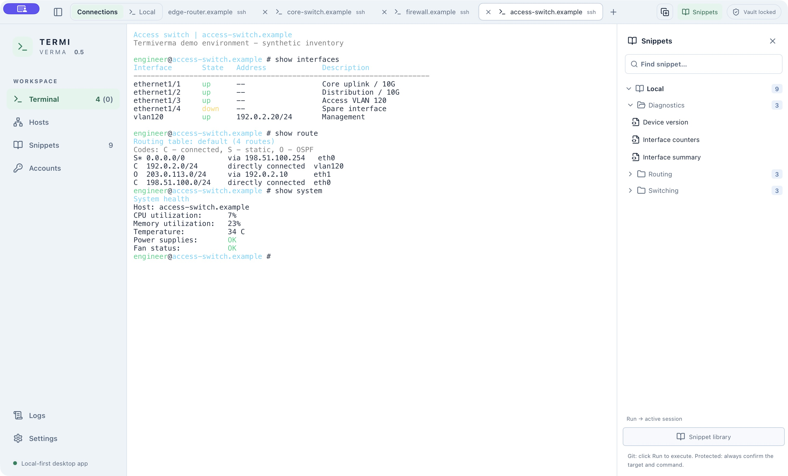
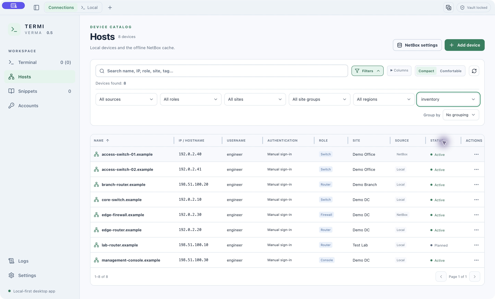
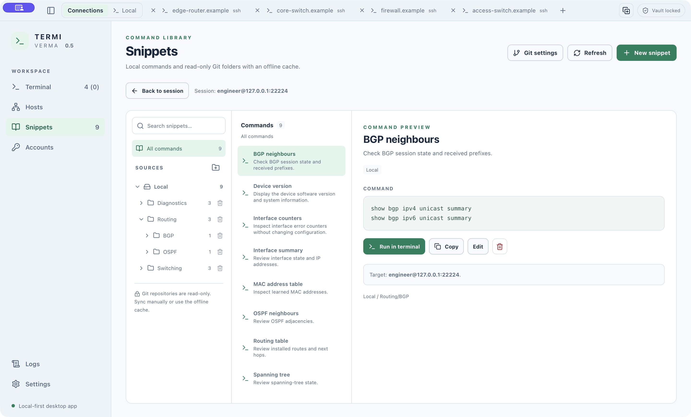
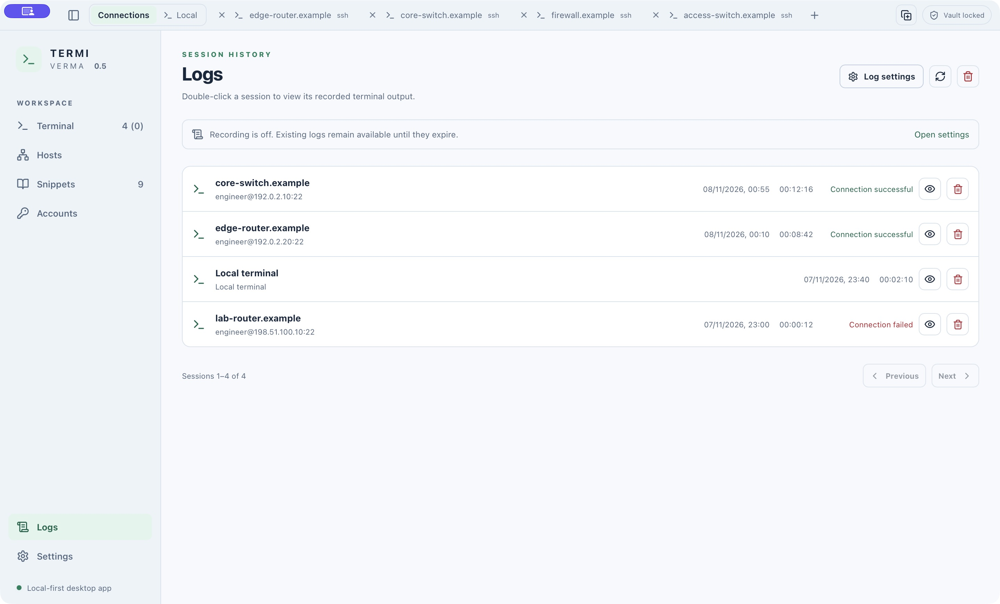
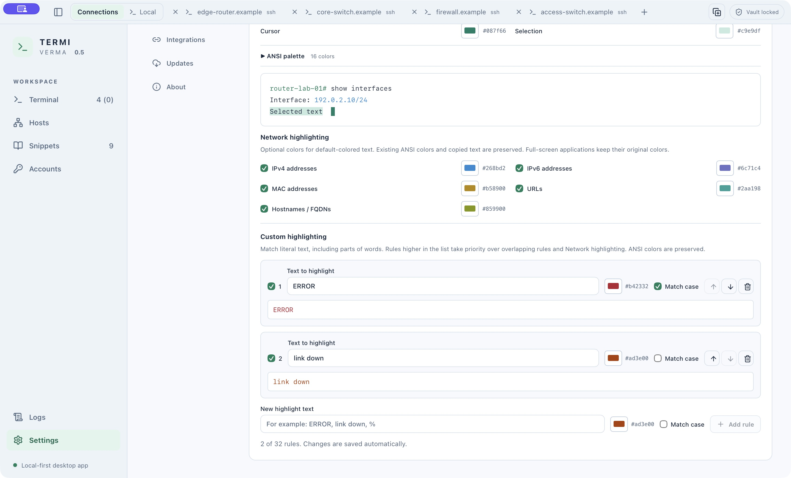
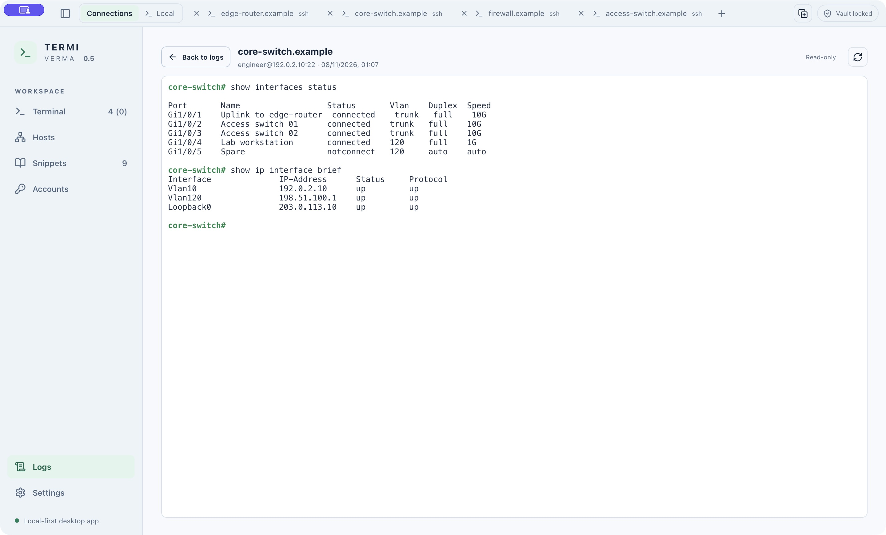

# Termiverma

**SSH, Telnet and local terminals for network engineers on macOS and Linux.**

[Download the latest release](https://github.com/zaverma/termiverma-releases/releases/latest)
· [All releases](https://github.com/zaverma/termiverma-releases/releases)
· [Website](https://zaverma.com)

Termiverma brings terminal sessions, device inventory, saved accounts and command
snippets into one desktop workspace. **Version 0.5** adds split Workspaces,
live transfers between windows, optional terminal Logs and custom highlighting.

This repository distributes application binaries, update metadata and release
notes. Termiverma is proprietary commercial software by **zaverma**; its source
code is not distributed here.

## At a glance

| Feature | What you can do |
| --- | --- |
| **Terminals** | Connect over SSH or Telnet, open local shells, search output and manage separate Connections / Local tab groups. |
| **Workspaces** | Combine up to four terminals in columns, rows or a 2×2 grid; resize, detach and move live sessions between windows. |
| **Hosts and NetBox** | Search local devices and an offline NetBox cache, filter and group inventory, and save your table layout. |
| **Accounts** | Reuse saved username/password accounts and integration tokens from an encrypted local Vault. |
| **Snippets** | Organize commands in nested folders or sync multiple read-only Git libraries, including their directory structure. |
| **Terminal Logs** | Opt in to local session recording and read-only playback, with configurable retention. Recording starts **off**. |
| **Appearance** | Use English or Ukrainian, Light / Dark / System appearance, terminal palettes and custom word highlighting. |
| **Updates** | Check for signed in-app updates on supported macOS bundles and Linux AppImages. |

## Screenshots

Screenshots use demonstration data with example hostnames and addresses.

**SSH terminal and live tabs**



| Hosts catalogue | Snippets library |
| --- | --- |
|  |  |
| **Session Logs** | **Custom highlighting** |
|  |  |

<details>
<summary>Recorded terminal output</summary>



</details>

## Features in detail

### Connections and Workspaces

- Connect from Quick Connect, Hosts or connection history. Typed addresses are
  used as entered, with an IP's CIDR suffix removed before connecting. Inventory
  suggestions are selected explicitly; they never replace your address silently.
- SSH negotiates modern algorithms first and includes compatibility support for
  supported older network equipment. Host-key verification is mandatory: first
  use asks for trust, and changed keys require review of both fingerprints and
  explicit acceptance before authentication.
- Use password, keyboard-interactive, supported local identity-file or SSH-agent
  authentication. Accounts stores saved passwords; saved private keys are not
  included.
- Drag a tab onto another terminal's edge to create a Workspace. Hold the active
  tab over a different tab to reveal its terminal before dropping. Up to four
  panes support columns, rows and a **2×2** grid. Resize boundaries, detach a pane
  into an ordinary tab or move individual terminals between application windows
  while retaining the live connection and output.
- Reorder or rename tabs, choose remote-tab title formats, search output and
  reconnect ended sessions. Local terminals open a shell in your home directory.
  Switching Connections / Local retains running sessions. Closing a window ends
  its sessions; sessions in other windows continue.
- Customize terminal palettes and highlighting for network addresses, URLs and
  hostnames. Add literal word, phrase and symbol rules with custom colors, case
  sensitivity and priority; changes apply to open terminals.

### Hosts and read-only NetBox inventory

- Search, filter, group and sort devices; inspect their details in a side panel.
  Expand filters and grouping from **Filters**, choose visible **Columns** and
  switch between Compact / Comfortable density. Column order, manually resized
  widths and density are remembered. Automatic columns fit displayed content
  and share unused width evenly.
- Sync one NetBox source using Primary IP, with role/status filters, an address
  preference and available Site Group / Region hierarchy. Keep the last complete
  cache available offline. Refreshes preserve local connection and account
  overrides and never write inventory changes back to NetBox.
- Resume manual Sync after Vault unlock and retain selected role names. Optional
  background refresh has a configurable timer, starts disabled, pauses while the
  application or Vault is locked and preserves the cache if a refresh fails.
- Choose a default SSH account, select an account per device or sign in manually.

### Encrypted Vault and command snippets

- Store username/password accounts and integration tokens in a locally encrypted
  Vault. Application lock and Vault have configurable inactivity timeouts.
  Turning off the UI lock keeps Vault encrypted at rest.
- Create local snippets in nested folders or sync multiple public/private HTTPS
  Git repositories. Git credentials or a Vault-stored access token can be used.
  Repository directory structure and the offline cache are preserved. Removing
  a repository from Termiverma does not delete its remote repository.
- Run a command explicitly from the library or the resizable Snippets panel.
  **Protected** snippets require confirmation of the target and final command
  before each run. Syncing or selecting a snippet does not execute it. Git sync
  is read-only; publishing snippets from the app is outside its scope.

### Terminal Logs

- **Logs**, above Settings in the sidebar, lists recorded terminal sessions with
  their time and SSH connection result. Local terminals have no connection status;
  Telnet reports client startup without claiming a verified connection or login.
- Double-click a session, press Enter or use View to open its output read-only,
  with recorded ANSI colors and terminal size changes. Viewing a log does not
  reconnect or send commands to a device.
- Recording is **off by default**. Enable **Settings → Logs → Record terminal
  sessions**, choose retention from **1 to 365 days** (default **30**), then open a
  new terminal. Disabling stops current recordings and keeps existing history
  until expiry. Earlier sessions cannot be recovered retroactively.
- Expired records are deleted automatically; individual deletion and Clear are
  available. Recording is limited to 16 MiB per session and marks incomplete
  records if the limit or recording backpressure is reached. The viewer also
  bounds its retained scrollback and labels any display limit.
- Output is stored locally **without encryption** and may contain sensitive text
  printed by a device. Hidden password input, credential-provider secrets and
  application authentication challenges are not recorded. Journals are not
  uploaded to Git or NetBox.

## Installation

Download assets only from the [release page](https://github.com/zaverma/termiverma-releases/releases/latest)
and choose the package for your operating system and CPU architecture. Packages
are listed on each release; a format or architecture mentioned here is not a
promise that it is available in every release.

### macOS — Apple Silicon

1. Download the `.dmg`, open it and drag **Termiverma.app** into **Applications**.
2. Eject the disk image and launch Termiverma from Applications.

The current macOS distribution targets Apple Silicon. It uses ad-hoc application
signing and is not Apple-notarized; macOS may restrict the first launch. If you
choose to allow it, use the per-application approval in **System Settings →
Privacy & Security** after the blocked launch. Availability of that approval can
depend on the Mac's security policy. The updater's signature is separate from
Apple Developer ID signing and notarization. See
[Apple's guidance on opening downloaded apps](https://support.apple.com/en-us/102445).

### Linux — AppImage

Download the AppImage for your architecture, place it in a permanent location,
make it executable and run it. For example, in the download directory:

```sh
chmod +x ./Termiverma_*.AppImage
```

Launch the downloaded AppImage from your file manager. After its first run,
Termiverma adds a user-level desktop launcher and application icons; pin it using
your desktop environment's normal dock/favorites action. Moving the AppImage and
running it from the new location updates the app-managed launcher.

In-app Linux installation of updates applies to **AppImage**. If a release also
provides `.deb` or `.rpm` packages, install and update those using the relevant
package tools; they do not use the AppImage update path. Linux builds are
prepared separately, and compatibility can vary with the distribution and
desktop environment.

Git synchronization requires an installed `git` client. Telnet requires an
installed `telnet` client available to the application.

## Keyboard shortcuts

| Action | macOS | Linux |
| --- | --- | --- |
| New tab in the selected Connections / Local group | ⌘T | Ctrl+T |
| Close the active tab | ⌘W | Ctrl+W |
| New application window | ⌘Shift+N | Ctrl+Shift+N |
| Switch the active Workspace pane | ⌘Option+Arrow | Ctrl+Alt+Arrow |
| Search the active terminal output | ⌘F | Ctrl+F |
| Next / previous search match, from the search input | Enter / Shift+Enter | Enter / Shift+Enter |
| Close terminal search | Escape | Escape |
| Rename a focused tab | F2 | F2 |
| Copy selected terminal output | ⌘C | Ctrl+Shift+C, or Ctrl+C with a selection |

On Linux, Ctrl+C without a selection retains its normal terminal interrupt
behavior. Tab shortcuts act on the current window and group; the permanent
Quick Connect home is not closed by Close tab. A tab can also be renamed by
double-clicking it or using its context menu. macOS additionally offers **File →
New Window** and **New Window** in the Dock menu.

## Updates and download files

Use **Settings → Updates** to check for a newer version. Installation requires an
eligible packaged build and a published update for its platform. An update does
not restart the application without your choice; restarting ends open sessions
across all Termiverma windows.

Release assets may include `.sig`, `latest.json` and `SHA256SUMS` alongside the
installers. Signature and manifest files support the in-app updater; they are
not applications to open. `SHA256SUMS` lets you compare downloaded files with the
published checksums. Signature verification remains mandatory before an in-app
update is installed.

## Scope and ownership

Version 0.5 does not include serial/USB console access, SCP/SFTP transfers,
configuration comparison, bulk snippet jobs, data import/export or KeePassXC
integration. Encrypted terminal journals and log export remain planned. Native
interaction checks for the new Workspaces and Logs interfaces, and Linux runtime
qualification, remain outstanding.

Product information and contact: [zaverma.com](https://zaverma.com).

Copyright © 2026 zaverma. All rights reserved. Termiverma is proprietary software;
public access to release files does not grant a license to its source code.
Third-party components retain their respective licenses and notices.
