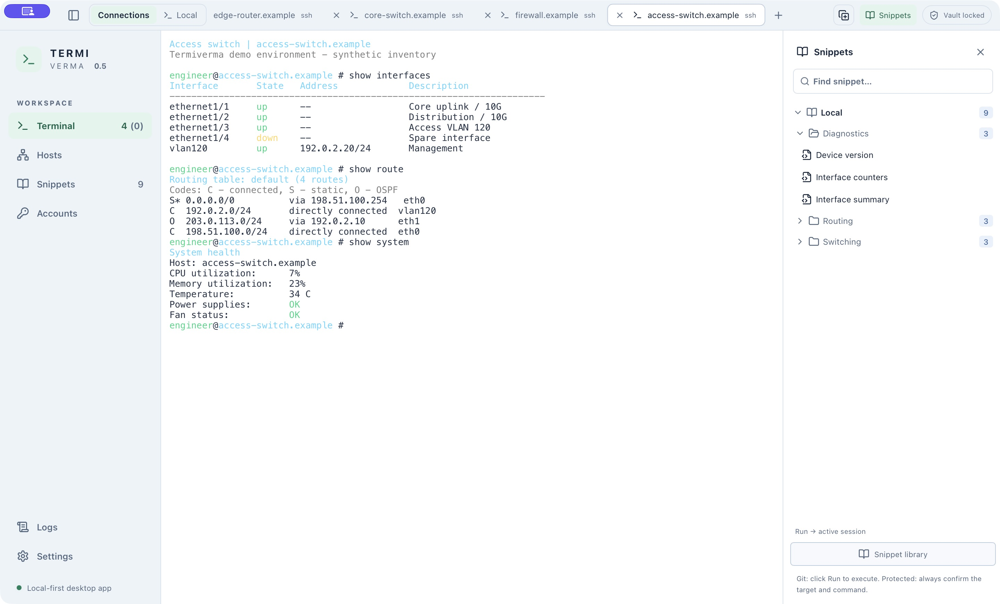
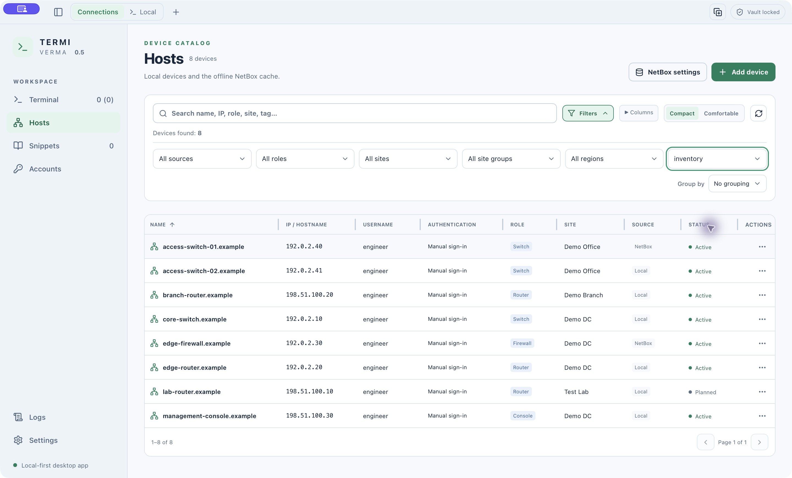
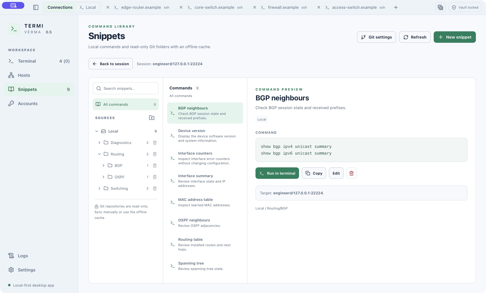
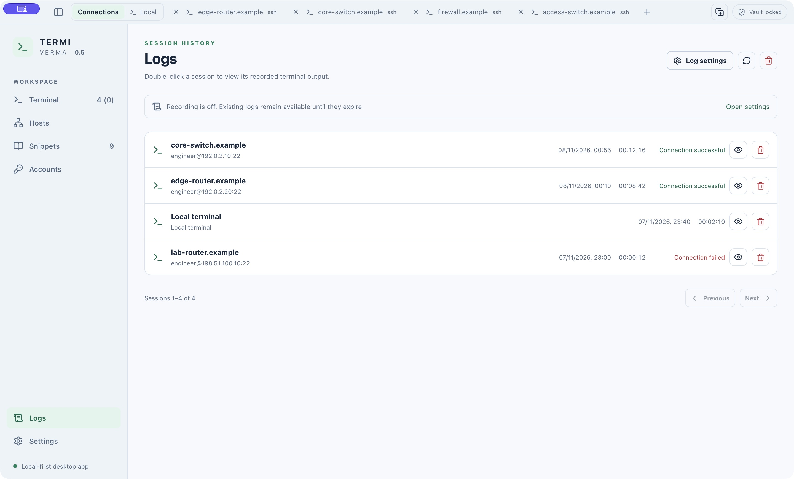
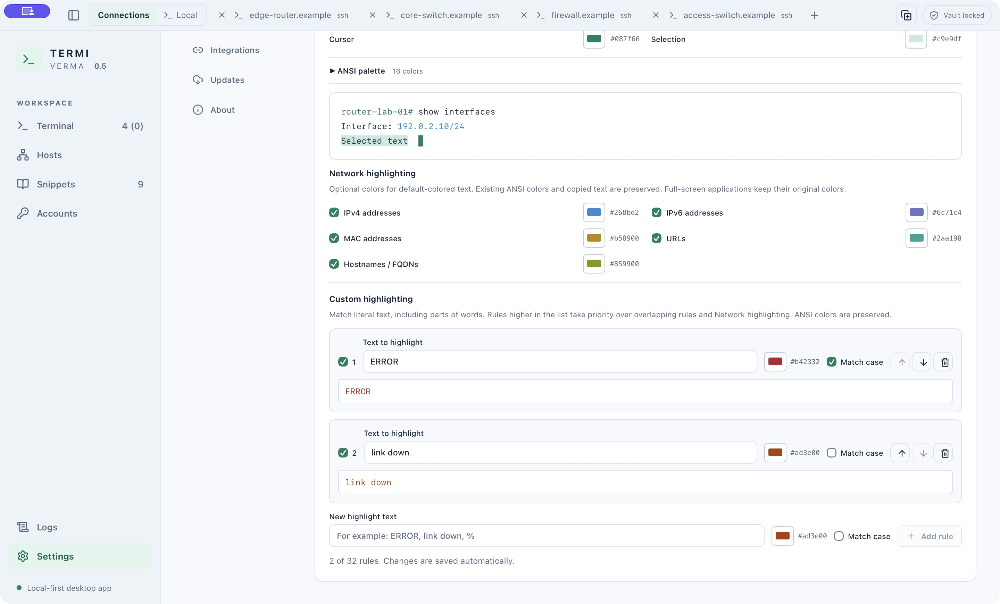
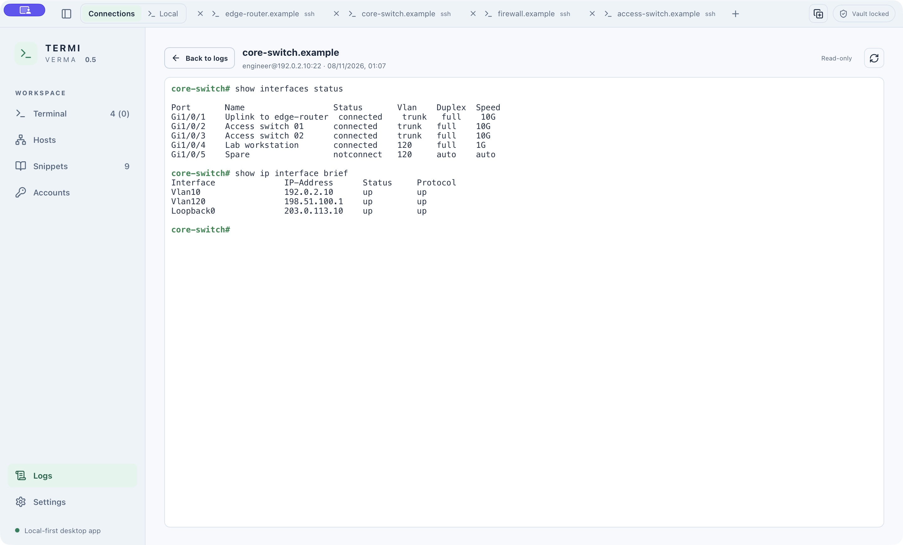

# Termiverma

**SSH, Telnet and local terminals for network engineers on macOS and Linux.**

[Download the latest release](https://github.com/zaverma/termiverma-releases/releases/latest)
· [All releases](https://github.com/zaverma/termiverma-releases/releases)
· [Website](https://zaverma.com)

Termiverma brings terminal sessions, device inventory, saved accounts and command
snippets into one desktop workspace. Split terminals, connect through an SSH
bastion, keep an offline inventory and reuse command libraries. **Factory for
Pro** runs snippets or local Ansible playbooks against selected devices, with a
queue, per-device results and cancellation.

**Version covered: 0.6.3.** Available installers and their release notes are listed
on the [release page](https://github.com/zaverma/termiverma-releases/releases/latest).

This repository distributes application binaries, update metadata and release
notes. Termiverma is proprietary commercial software by **zaverma**; its source
code is not distributed here.

## What's new in 0.6.3

- **Network Ansible playbooks:** Factory supports `ansible.netcommon.network_cli`
  through libssh, including Cisco IOS mappings and saved Vault passwords.
- **Explicit Enter input:** blank rows in Factory snippets are preserved, so
  authored Enter responses are sent with their preceding command. Confirmation
  replies are not generated automatically.
- **Readable Factory output:** fragmented text is joined into lines with device
  names and addresses; Ansible command-output lists are displayed in order.
- **macOS refinements:** rounded tabs and Workspaces, updated native window
  corners on macOS 26+, aligned window controls and no redundant Plus inside
  New connection tabs. The separate new-tab button remains available.

## At a glance

| Feature | What you can do |
| --- | --- |
| **Terminals** | Connect over SSH or Telnet, open local shells, search output and manage separate Connections / Local tab groups. |
| **Workspaces** | Combine up to four terminals in columns, rows or a 2×2 grid; resize, detach and move live sessions between windows. |
| **SSH bastion** | Assign an inventory host as a gateway and save SSH/Telnet routes per device or choose a gateway in Quick Connect. |
| **Hosts and NetBox** | Search local devices and an offline NetBox cache, filter and group inventory, customize role colors and save your table layout. |
| **Accounts** | Reuse saved username/password accounts and integration tokens from an encrypted local Vault. |
| **Snippets** | Organize commands in nested folders or sync multiple read-only Git libraries, with optional background refresh. |
| **Factory — Pro** | Run reviewed SSH snippet jobs or local Ansible playbooks against selected devices; track progress, output and cancellation. |
| **Terminal Logs** | Opt in to local session recording and read-only playback, with configurable retention. Recording starts **off**. |
| **Appearance** | Use English or Ukrainian, Light / Dark / System appearance, adjustable terminal text size, palettes and custom word highlighting. |
| **Updates** | Check for signed in-app updates on supported macOS bundles and Linux AppImages. |

## Screenshots

Screenshots use demonstration data with example hostnames and addresses. They
show an earlier interface; some controls and layouts differ from version 0.6.3.

**SSH terminal and live tabs**



| Hosts catalogue | Snippets library |
| --- | --- |
|  |  |
| **Session Logs** | **Custom highlighting** |
|  |  |

<details>
<summary>Recorded terminal output</summary>



</details>

## Features in detail

### Connections and Workspaces

- Connect from Quick Connect, Hosts or connection history. Typed addresses are
  used as entered, with an IP's CIDR suffix removed before connecting. Inventory
  suggestions are selected explicitly; they never replace your address silently.
- SSH negotiates modern algorithms first and includes compatibility support for
  supported older network equipment. Host-key verification is mandatory: first
  use asks for trust, and changed keys require review of both fingerprints and
  explicit acceptance before authentication.
- Use password, keyboard-interactive, supported local identity-file or SSH-agent
  authentication. Accounts stores saved passwords; saved private keys are not
  included.
- Mark an inventory host as an **SSH jump host / bastion** and assign it to
  other hosts, or choose a gateway in Quick Connect. A route uses one SSH gateway;
  the destination keeps its own SSH/Telnet protocol, port and account. Saved
  Telnet credentials are supported through the bastion with explicit approval
  before sending them. Direct Telnet sign-in remains manual; the Telnet leg
  between the bastion and destination is not encrypted.
- Drag a tab onto another terminal's edge to create a Workspace. Hold the active
  tab over a different tab to reveal its terminal before dropping. Up to four
  panes support columns, rows and a **2×2** grid. Resize boundaries, detach a pane
  into an ordinary tab or move individual terminals between application windows
  while retaining the live connection and output.
- Reorder or rename tabs, duplicate a connection from its context menu, choose
  remote-tab title formats, search output and reconnect ended sessions.
  Duplicate opens an independent session. Local terminals open a shell in your
  home directory.
  Switching Connections / Local retains running sessions. Closing a window ends
  its sessions; sessions in other windows continue.
- Customize terminal palettes and highlighting for network addresses, URLs and
  hostnames. Add literal word, phrase and symbol rules with custom colors, case
  sensitivity and priority; changes apply to open terminals and refresh while
  scrolling through history.
- Set terminal text size from **8 to 32 px** in **Settings → Terminal**, with a
  preview and reset. Open terminals and Workspace panes update without reconnecting.
  Terminal palettes are configured separately from the application's theme.
- macOS uses rounded tabs with close buttons shown on hover or keyboard focus.
  Linux provides minimize, maximize/restore and close controls, plus mouse-wheel
  and horizontal trackpad scrolling for overflowing tab lists.
- Choose the preferred browser for NetBox pages and external links in Settings.
  Connection errors can be expanded and copied for troubleshooting.

### Hosts and read-only NetBox inventory

- Search, filter, group and sort devices; inspect their details in a side panel.
  Expand filters and grouping from **Filters**, choose visible **Columns** and
  switch between Compact / Comfortable density. Column order, manually resized
  widths and density are remembered. Automatic columns fit displayed content
  and share unused width evenly.
- Sync one NetBox source using Primary IP, with role/status filters, an address
  preference and available Site Group / Region hierarchy. Keep the last complete
  cache available offline. Refreshes preserve local connection and account
  overrides and never write inventory changes back to NetBox.
- Resume manual Sync after Vault unlock and retain selected role names. Optional
  background refresh has a configurable timer, starts disabled, pauses while the
  application or Vault is locked and preserves the cache if a refresh fails.
- Choose a default SSH account, select an account per device or sign in manually.
- Assign local display colors to device roles. Colors appear in role badges,
  groups and Device Inspector without changing the role name or NetBox data.

### Encrypted Vault and command snippets

- Store username/password accounts and integration tokens in a locally encrypted
  Vault. Application lock and Vault have configurable inactivity timeouts.
  Turning off the UI lock keeps Vault encrypted at rest.
- Create local snippets in nested folders or sync multiple public/private HTTPS
  Git repositories. Git credentials or a Vault-stored access token can be used.
  Repository directory structure and the offline cache are preserved. Removing
  a repository from Termiverma does not delete its remote repository.
- Enable optional background Git refresh with a saved timer in **Settings →
  Integrations → Git Sync**. It starts disabled, pauses while the application is
  locked and waits for Vault unlock when a saved repository token is needed.
- Run a command explicitly from the library or the resizable Snippets panel.
  **Protected** snippets require confirmation of the target and final command
  before each run. Syncing or selecting a snippet does not execute it. Git sync
  is read-only; publishing snippets from the app is outside its scope.

### Factory — Pro automation

- Select Inventory devices and an existing snippet or local YAML playbook.
  Review the exact commands/resource, targets and execution settings before
  confirming the run. Factory requires a valid Pro license with **Factory** access.
- First connect to each target interactively to review and trust its SSH host
  key. Factory stops on unknown or changed keys instead of accepting them silently.
- Jobs use an application-wide FIFO queue, with one active job at a time.
  Configure concurrent devices and Ansible forks from **1 to 20** (default **5**),
  connection/command timeouts and the Ansible job timeout in Settings.
- Snippet jobs create **independent SSH connections**, leaving your interactive
  terminals available. Supported CLI profiles include Cisco IOS / IOS XE /
  NX-OS / ASA and MikroTik RouterOS. One inventory SSH bastion is supported for
  snippet jobs.
- Commands run in order with prompt-based completion. A command and its following
  blank rows are sent together as explicit Enter input before waiting for the
  next prompt. Paging, additional credentials, CLI errors or insufficient input
  stop the affected target; the app does not invent confirmation responses.
- Ansible runs on your computer using an installed **`ansible-playbook`**.
  Settings can detect it or use an explicit executable path. Map each inventory
  platform to a supported connection plugin; Network CLI also requires an
  explicit Ansible network OS, such as `cisco.ios.ios`.
- Supported Ansible connections are **`ansible.builtin.ssh`** and
  **`ansible.netcommon.network_cli` through libssh**. Network CLI saved passwords
  work with ansible-core **2.18 / 2.19**; builtin SSH saved passwords require
  **2.19**. Network CLI also supports one unencrypted identity file, but not
  agent-only authentication, encrypted-key passphrases, MFA or `enable`/`become`.
  Ansible routes through a bastion are not supported.
- For Cisco IOS playbooks, install **`ansible.netcommon`**, **`cisco.ios`** and
  **`ansible-pylibssh 1.4.x`** in the environment used by the selected Ansible
  executable. Termiverma does not install Ansible, collections or Python packages
  automatically.
- View progress, connection results, readable device output and cancellation
  from Factory or its activity indicator. Jobs continue when you navigate to
  another page or close an individual window. Quitting the application ends
  execution; already accepted remote commands cannot be rolled back.

Factory results and output are **temporary, size-limited and cleared on exit**.
Any output truncation is marked in the interface. These results are separate
from optional terminal Logs. Persistent Factory history,
exports, scheduling and recovery after restart are not included. Local playbooks
run with your user permissions; selecting Inventory targets is not a sandbox
for playbook code.

### Free, Pro and Team

- **Free** includes SSH/Telnet and Local terminals, Workspaces, Hosts, accounts,
  ordinary snippets, Git/NetBox integration, highlighting and optional terminal
  Logs. Licensing adds no host or tab limits to these existing features.
- **Pro** adds Factory execution. In **Settings → License**, export an activation
  request, obtain a signed license from the author and import the `.lic` file.
  Licenses are time-limited and bound to the installation; verification works
  offline. The license must include Factory access; an older Pro license may
  need to be reissued.
- When Pro expires, existing Free features and user data remain available.
  Accepted jobs can finish; while the app is unlocked, you can still inspect
  their results and cancel ongoing jobs. New runs and queued-job dispatch need
  a valid license.
- **Team** is planned: employee license management, shared inventory/snippets,
  connection audits and permission-controlled server-side execution. These
  services and online activation are not part of version 0.6.3.

### Terminal Logs

- **Logs**, above Settings in the sidebar, lists recorded terminal sessions with
  their time and SSH connection result. Local terminals have no connection status;
  Telnet reports client startup without claiming a verified connection or login.
- Double-click a session, press Enter or use View to open its output read-only,
  with recorded ANSI colors and terminal size changes. Viewing a log does not
  reconnect or send commands to a device.
- Recording is **off by default**. Enable **Settings → Logs → Record terminal
  sessions**, choose retention from **1 to 365 days** (default **30**), then open a
  new terminal. Disabling stops current recordings and keeps existing history
  until expiry. Earlier sessions cannot be recovered retroactively.
- Expired records are deleted automatically; individual deletion and Clear are
  available. Recording is limited to 16 MiB per session and marks incomplete
  records if the limit or recording backpressure is reached. The viewer also
  bounds its retained scrollback and labels any display limit.
- Output is stored locally **without encryption** and may contain sensitive text
  printed by a device. Hidden password input, credential-provider secrets and
  application authentication challenges are not recorded. Journals are not
  uploaded to Git or NetBox.

## Installation

Download assets only from the [release page](https://github.com/zaverma/termiverma-releases/releases/latest)
and choose the package for your operating system and CPU architecture. Packages
are listed on each release; a format or architecture mentioned here is not a
promise that it is available in every release.

### macOS — Apple Silicon

1. Download the `.dmg`, open it and drag **Termiverma.app** into **Applications**.
2. Eject the disk image and launch Termiverma from Applications.

The current macOS distribution targets Apple Silicon. It uses ad-hoc application
signing and is not Apple-notarized; macOS may restrict the first launch. If you
choose to allow it, use the per-application approval in **System Settings →
Privacy & Security** after the blocked launch. Availability of that approval can
depend on the Mac's security policy. The updater's signature is separate from
Apple Developer ID signing and notarization. See
[Apple's guidance on opening downloaded apps](https://support.apple.com/en-us/102445).

### Linux — AppImage

Download the AppImage for your architecture, place it in a permanent location,
make it executable and run it. For example, in the download directory:

```sh
chmod +x ./Termiverma_*.AppImage
```

Launch the downloaded AppImage from your file manager. After its first run,
Termiverma adds a user-level desktop launcher and application icons; pin it using
your desktop environment's normal dock/favorites action. Moving the AppImage and
running it from the new location updates the app-managed launcher.

In-app Linux installation of updates applies to **AppImage**. If a release also
provides `.deb` or `.rpm` packages, install and update those using the relevant
package tools; they do not use the AppImage update path. Linux builds are
prepared separately, and compatibility can vary with the distribution and
desktop environment.

Git synchronization requires an installed `git` client. Direct Telnet requires
a local `telnet` client available to the application; a Telnet route through a
bastion needs that client on the gateway. Factory playbooks also require a
compatible local Ansible environment as described above.

## Keyboard shortcuts

| Action | macOS | Linux |
| --- | --- | --- |
| New tab in the selected Connections / Local group | ⌘T | Ctrl+T |
| Close the active tab or Workspace pane | ⌘W | Ctrl+W |
| New application window | ⌘Shift+N | Ctrl+Shift+N |
| Open / close Snippets for the active terminal | ⌘Shift+S | Ctrl+Shift+S |
| Switch the active Workspace pane | ⌘Option+Arrow | Ctrl+Alt+Arrow |
| Search the active terminal output | ⌘F | Ctrl+F |
| Next / previous search match, from the search input | Enter / Shift+Enter | Enter / Shift+Enter |
| Close terminal search or Snippets, with focus inside the panel | Escape | Escape |
| Rename a focused tab | F2 | F2 |
| Open the focused tab's context menu | Shift+F10 | Shift+F10 |
| Copy selected terminal output | ⌘C | Ctrl+Shift+C, or Ctrl+C with a selection |

On Linux, Ctrl+C without a selection retains its normal terminal interrupt
behavior. In a Workspace, Close acts on the active pane. Tab shortcuts act on
the current window and group; the permanent Quick Connect home is not closed
by Close tab. A tab can also be renamed by
double-clicking it or using its context menu. macOS additionally offers **File →
New Window** and **New Window** in the Dock menu.

**Settings → Keyboard shortcuts** shows the combinations for your current
platform. The Snippets shortcut acts on the active terminal and is unavailable
while application content is locked or an approval dialog is open.

## Updates and download files

Use **Settings → Updates** to check for a newer version. Installation requires an
eligible packaged build and a published update for its platform. An update does
not restart the application without your choice; restarting ends open sessions
across all Termiverma windows and waits for Factory shutdown and cleanup.

Release assets may include `.sig`, `latest.json` and `SHA256SUMS` alongside the
installers. Signature and manifest files support the in-app updater; they are
not applications to open. `SHA256SUMS` lets you compare downloaded files with the
published checksums. Signature verification remains mandatory before an in-app
update is installed.

## Scope and ownership

Version **0.6.3** does not include serial/USB console access, SCP/SFTP transfers,
configuration comparison, general data import/export, KeePassXC integration or
server-side jobs. Encrypted terminal journals, terminal-log export and persistent
Factory history remain planned. Factory's current local execution is available
with Pro; it is distinct from these planned extensions.

Network CLI checks use local synthetic SSH/Ansible fixtures; they do not establish
compatibility with every physical device or collection version. Native GUI,
distribution-specific Linux behavior and the reported macOS Dock duplication
after an update still require platform-specific qualification.

Product information and contact: [zaverma.com](https://zaverma.com).

Copyright © 2026 zaverma. All rights reserved. Termiverma is proprietary software;
public access to release files does not grant a license to its source code.
Third-party components retain their respective licenses and notices.
See [Third-party notices](THIRD_PARTY_NOTICES.txt).
